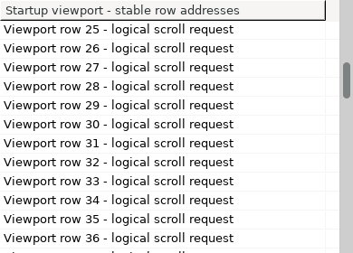

<!-- SPDX-License-Identifier: EPL-2.0 -->
# Preserve Grid startup scroll requests across native callbacks

The default Grid viewport now applies a valid `setTopIndex` request before the first paint, after row-count growth, and after a resize changes the scroll range. The repair also closes the previously reproduced `showSelection` startup failure. It keeps the requested public `GridItem` facade and its address until native scrollbar geometry settles, so synchronous listeners cannot redirect an old request to a replacement row.

This is an additive implementation successor to [Nebula #246](https://github.com/hsoliwal/nebula/pull/246), which retained the failing startup probe and rejected refresh prototype. [Nebula #245](https://github.com/hsoliwal/nebula/pull/245) retains the independent selection-occurrence repair and the [238-PR history audit](../viewport-history-20261017/README.md). The diagnostic and selection packets are unchanged. The history audit covers its pinned snapshot; runtime review is explicitly narrower than inventory and blob/ancestry review.

The source-only local commit is `9de9d28badd28e7f3619c81d3bff0254875fd96f`, with diagnostic local parent `d2e08231f221f2023ead1b2fbaa6d9d3f0c57229`. The public stack parent is `7c2c52dde4226265b5492b3904f188371ec39201`. The canonical packet checks the relevant source/POM preimages and new-test absence against that immutable public parent; it does not claim that the complete local and remote documentation trees are identical.

## Why the request was lost

The prior `setTopIndex` path returned while the vertical scrollbar was still hidden. A populated Grid that had not painted could therefore silently retain top row 0 after `setTopIndex(12)`. Once a paint configured the bar, the identical call succeeded. A visible bar could also retain an obsolete range after `setItemCount`, clamping a new request to the previous maximum.

The direct diagnostic uses a 200 × 200 Grid with 20 collapsed roots, each with three children: 80 logical rows and 20 visible rows. Before a paint, selecting logical rows `[4, 8, 24]`, requesting top 12, then calling `showSelection()` left top 0. The repaired default path reaches 12 and then reveals logical row 4 without changing selection.

A synchronous refresh crosses existing native callback boundaries. SWT `ScrollBar.setVisible` sends Show/Hide and owner Resize events; application listeners may request another top row, mutate rows or columns, resize the Grid, freeze a plane, or dispose widgets. The first naive refresh prototype failed inside unpatched SWT when a Show listener disposed its owner. That rejected proof remains in #246.

## What the received source changes

The change remains in the existing `Grid` owner and uses its existing range calculation, visible-rank mapping, viewport notifications and frozen planes.

- A pending request stores the existing facade together with its logical index. The latest valid callback request wins. Before applying it, Grid checks that the item is live, remains at the same address, and remains visible. A removed or moved target cannot scroll an unrelated replacement at its old index.
- A guarded scrollbar refresh admits synchronous callbacks and checks liveness after every native visibility/range boundary. A bounded three-pass wrapper verifies both preferred content extents and current client bounds. Unsettled geometry remains dirty for a later pass; callback code cannot cause an unbounded refresh loop.
- Nested `PLANE_SCROLLBARS` freezes retain the latest request until the final thaw. Existing body/chrome ownership remains in the current plane machinery.
- If a listener disposes only a native scrollbar, Grid retires its original adapter before a later request can use it. An independently installed external proxy survives this retirement because the check is by adapter identity.
- The refresh clears its own obsolete state before delivering the pending viewport notification. New invalidation raised by that listener survives the paint caller. An immediate `getTopIndex()` after a resize settles the new clamp when needed; repeated unchanged prepaint requests reuse the already settled range.

There is one production source target, one new 20-case JUnit target, and a small test POM target. The POM discovers `GridTopIndexStartup_Test` and sets `GTK_OVERLAY_SCROLLING=0` in the forked test process. The GTK pixel assertion checks that setting; the assertion is conditional on `SWT.getPlatform()` being `gtk`. This uses Tycho's documented [environmentVariables parameter](https://tycho.eclipseprojects.io/doc/4.0.2/tycho-surefire-plugin/test-mojo.html#environmentVariables). Full Tycho execution was not performed in this proof.

## Received-source proof

The final [native result](evidence/received-native/result.json) comes from the canonical driver after receipt of the qualified SDK Results. Both sides compiled all 105 core widget Java sources against the same admitted SWT runtime. Compilation emitted no diagnostics, and the public Grid JVM descriptors were identical. The 10 JFace adapter sources are outside this focused compilation.

| Lane | Tests | Failures | Meaning |
| --- | ---: | ---: | --- |
| Unchanged Grid, default mode | 20 | 19 | Required failing-before control; one existing scenario already passed |
| Received Grid, default mode | 20 | 0 | Corrected startup and callback contract |
| Received Grid, `-Dswt.widget.mode.Grid=original` | 20 | 0 | Mode-aware compatibility with historical original behavior |
| Received Grid, retained selection suites | 11 | 0 | Selection occurrence, list and cell-selection regression checks |

Every executed method has one terminal record; there are no missing, duplicate, ignored or assumption-skipped methods. **Original mode intentionally preserves the old startup behavior**, including top 0 where the historical path ignores a prepaint request. Its 20/20 result is compatibility evidence, not evidence that original mode now implements the repaired default behavior.

The focused cases cover collapsed trees, new range growth, resize, latest callback request, removed and moved targets, changed client bounds, Grid and scrollbar disposal, external proxy preservation, viewport-listener invalidation, repeated requests, nested freeze/thaw, and a 10-million-row virtual Grid. The sparse case reaches logical row 9,000,000 with no `SetData` callback and at most three existing facades: the target plus the current extent endpoints. The target identity remains stable.

### Full native pixels

Each pair uses `GridSwtScreenshotCapture` and asserts `DISPLAY_COPY_AREA`; these are visible-screen captures through SWT `GC(display).copyArea`. Every image is the complete 390 × 280 control. No crop or mask participates in the equality oracle.

GTK overlay scrollbar animation was excluded deterministically with `GTK_OVERLAY_SCROLLING=0` at launch. The [persisted OpenCV receipt](evidence/received-native/startup-pixels.json) reuses Nebula's existing PNG hash/decode and frame-change checks, verifies dimensions and nonblank interior content, and confirms:

| Pair | Different pixels out of 109,200 |
| --- | ---: |
| Unchanged default: first paint versus settled requested top | 11,463 |
| Repaired default: first paint versus settled requested top | 0 |
| Original compatibility: first paint versus its historical reference | 0 |

The repaired first frame also exactly matches the unchanged Grid's correctly scrolled, already-settled reference. This distinguishes the desired initial viewport from a pair of equally stale frames. The complete captures and their SHA-256 identities are retained alongside the receipt. The existing full eight-scene Grid/graphics-lifetime validator and the combined SWT/Nebula resource gate were not run by this focused proof.

### Required SWT dependency

The successful disposal cases use the admitted fork-built SWT callback correction, with `ScrollBar.java` SHA-256 `b2cc90ce5b7f3f706a758099eacdca8199cae5ac53f7b44cdb9beb779aa09966` and local source revision `64b93072569e9f9749d30a065c793fca865ff16e`. It is published as [SWT #221](https://github.com/hsoliwal/eclipse.platform.swt/pull/221), head `8f5c591ae92e5807a979552376fd91d167c04c6b`, stacked above SWT #220, public base `bff9c98564a575781d9a19f61dc5561c1d13ce2a`. The callback recipe is published in [Synexia #12129](https://github.com/hsoliwal/com.synexia/pull/12129), canonical revision `893118ced3ba18f97633c24c8090d1aa83b4113c`. The published source corresponds to the admitted runtime bytes; these links do not substitute for the retained native proof.

This runtime uses admitted callback classes first, then the current-source GTK classes/resources, with SWT-built native libraries. The exact class/resource/native identities are in [inputs.json.gz](evidence/received-native/inputs.json.gz), and every argv is in [commands.json](evidence/received-native/commands.json).

Unpatched official SWT 3.135.0 did **not** pass the earlier disposal probes. The retained [15-case earlier staging log](evidence/earlier-comparisons/official-swt-earlier-staging.log) has two `NullPointerException` failures inside SWT `ScrollBar.setVisible`: disposing only the bar and disposing its owner. It is an earlier staging test version, not a run of the final received 20-case suite. The successful final proof must not be interpreted as official SWT 3.135.0 disposal qualification.

## Existing failing gates remain explicit

The earlier 98-method `Grid_Test` selection/scrolling filter ran with 13 failures on the unchanged baseline and six on the candidate; the overall legacy gate remains **failed**. The six remaining failures occur on both sides:

- `Grid_Test.testUpdateScrollBars_OnColumnWidthChange`
- `Grid_Test.testUpdateScrollBars_OnFooterVisible`
- `Grid_Test.testUpdateScrollBars_OnHeaderVisible`
- `Grid_Test.testUpdateScrollBars_OnItemExpandChange`
- `Grid_Test.testUpdateScrollBars_OnColumnChange`
- `Grid_Test.testUpdateScrollBars`

Seven previously failing methods no longer appear among the candidate failures: `testShowSelection`, `testSetTopIndex`, `testSetTopIndex_VisibleSubItem`, `testGetTopIndex_DifferentItemHeight`, `testGetTopIndex_OnItemAdd`, `testSetTopIndex_AdjustTopIndex`, and `testShowItem_ScrollUp`. In particular, the former 72/73 selection subgate's `testShowSelection` failure is closed. All 73 selection methods are contained in the 98-method filter; no additional standalone 73-method run is claimed.

The adjacent 14-test group has two failures on each side:

- `GridScrollbarSettle_Test.resizeSweepMatchesTheTwoPassAlgorithm`
- `GridBodyDefer_Test.sortFilterAndCountChangesPaintTheBodyOnce`

Those are pre-existing failing methods. The random resize sweep's first failing assertion differs, so this receipt does not claim identical assertion-level behavior or that every fixture cause has been independently proved. The fixture/paint timing suspicion is not used to waive a gate. These two methods and the six legacy methods remain visible for a separately qualified successor.

The earlier comparisons have explicit runtime boundaries in [EARLIER_COMPARISONS.json](evidence/EARLIER_COMPARISONS.json): the 98-method baseline used official SWT 3.135.0 and its candidate used the corrected fork runtime; the adjacent baseline used the admitted callback runtime. They are retained comparison observations, separate from the final homogeneous before/received-source proof. Their logs are not relabelled as complete green gates.

## Measurements and qualification limits

The final canonical-driver JVM observations used a 512 MiB heap cap:

| Received lane | Wall seconds | User CPU seconds | System CPU seconds | Peak RSS KiB |
| --- | ---: | ---: | ---: | ---: |
| Default startup | 1.211436 | 1.283881 | 0.136297 | 129556 |
| Original compatibility | 1.235797 | 1.195164 | 0.154366 | 134220 |
| Retained selection | 1.425607 | 2.156649 | 0.186810 | 143116 |

These are individual process observations, not statistical performance claims. The heap cap is not a measured heap result. Independent CPU/heap/native-memory budgets, the combined resource gate, full Maven/Tycho, JFace adapters, Win32, Cocoa and GTK4 remain `NOT_RUN`.

## Canonical receipt and reproduction

The recipe is `com.synexia.nebula.StartupScroll20261017`, canonical path `synexia-openrewrite-recipes/recipe-crates/m3-nebula-startup-scroll-20261017`. It reuses the Java21/OpenRewrite SDK engine at `892e3f6c51d78bc0948e8a8cf736055b4c70eafa`; the new crate is published at [f60dff56d006389d893dd45e513f39a20e18392e](https://github.com/hsoliwal/com.synexia/pull/12136). [CRATE.json](recipe/CRATE.json) seals all three preimages/postimages and their Git blobs. Five real Maven SDK tests passed, including exact output, fixed point and refusal controls. Receipt admitted three Results; immediate recheck reported zero changes. See [QUALIFICATION.json](QUALIFICATION.json) and the [SDK log](evidence/sdk-maven.log).

The reusable [native driver](verification/run_native_proof.py) refuses an existing output directory, compiles both sides, compares public descriptors, records source/dependency identities, executes the expected failing baseline and both mode lanes, and rejects missing, duplicate or skipped methods. It expects the adjacent `RunGridNativeProof.java.txt` helper. Use a fresh output and the source-bound SWT artifacts listed in the retained commands; run under `xvfb-run -a env GTK_OVERLAY_SCROLLING=0` with explicit `--target`, `--baseline`, `--output`, `--java-home`, `--swt-overlay`, `--swt-classes`, `--swt-native`, `--junit` and `--hamcrest` arguments.

The [focused persisted-pixel verifier](verification/verify_startup_pixels.py) takes that output directory and the existing `m3/convergence/verify_grid_screenshots.py` path. The executed dependency was `opencv-python-headless==4.12.0.88`; its OpenCV/NumPy versions are recorded in the pixel receipt. It reuses the existing validator primitives without claiming the unrun broader scene/resource acceptance.

The [offline authoring mirror](recipe/offline/SYNEXIA_HANDOFF.json) pins that published canonical revision and the SHA-256/Git blob of every mirrored source. All 15 SDK-bound inputs match the retained five-test execution; v2 corrected prose/provenance only. No fresh mirror Maven execution is claimed: run its documented Maven qualification before invoking its local receiver. See [MIRROR_QUALIFICATION.json](recipe/MIRROR_QUALIFICATION.json). It is authoring/qualification tooling, with no product runtime dependency.
